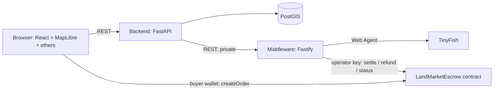

# Architecture

Land Market is a prototype: a government **ULPIN** is verified with TinyFish evidence, split
into tradeable **ALU** units, checked by six fixed rules, and settled through a testnet escrow.

## Components

| Part | Folder | Responsibility |
|---|---|---|
| Frontend | `frontend/` | Map and ALU layers, evidence and review screens, wallet connect, buy flow, trade status. Calls the backend; sends the buyer's payment to the contract directly from the wallet. |
| Backend | `backend/` | System of record. Parcels, ALU hierarchy, bundles, listings, orders, users/KYC stub, evidence storage and review, the six-check rule engine, ALU locking. Decides APPROVED / REJECTED / NEEDS_REVIEW. |
| Middleware | `middleware/` | Collects the 21-field evidence sheet with TinyFish and hashes it; holds the operator key and calls `settle()`, `refund()` and reads order status on the escrow contract. Makes no trade decisions. |
| Contract | `middleware/contracts/LandMarketEscrow.sol` | Holds the buyer's funds per order. Buyers create funded orders; only the operator can settle or refund. |
| Database | `backend/db/*.sql` | PostGIS schema, demo seed, bundles, ALU locks. |

## Order lifecycle

1. The buyer picks a `LISTED` listing; the backend creates an order (`CREATED`) after KYC and listing checks.
2. The frontend computes the on-chain order ID (`keccak("landmarket-order:<id>")`) and the buyer's wallet calls `createOrder`, sending the price into escrow. The backend records it as `FUNDED`.
3. `POST /orders/{id}/evaluate` runs the six checks: `LISTED`, `BUNDLE_INTACT`, `KYC_WALLET`, `ZONING_OK`, `FUNDS_IN_ESCROW`, `TRADE_MATCH`.
4. Decision: `APPROVED` calls `settle()` (seller is paid); `REJECTED` calls `refund()` (buyer is refunded); `NEEDS_REVIEW` makes no chain call and goes to the officer queue.
5. The UI shows the order state and the transaction hash.

Rules and formats are fixed in `docs/decisions.md` (ALU math, evidence hash, order ID, money) and `docs/checks.md` (the six checks).

## Trust boundaries

- **Evidence is not a decision.** TinyFish gathers facts; fixed backend rules decide. Missing data is `N/D`, never invented.
- **Only the backend talks to the middleware.** The middleware's settle and refund endpoints have no authentication of their own, so it must stay on a private network (`docs/deployment.md`).
- **Secrets:** the operator key and TinyFish key exist only in the middleware's environment. The frontend holds no secret except the demo-only `VITE_OFFICER_TOKEN`, which is public if set.
- **Testnet only.** No mainnet, no real money. Demo parcels are fixtures, not official records.

## Where to read next

`SETUP.md` (run it), `docs/api-keys-setup.md` (keys), `docs/api-contract.md` (API shapes), `docs/limitations.md` (what is not real), `docs/demo-script.md` (the demo).
